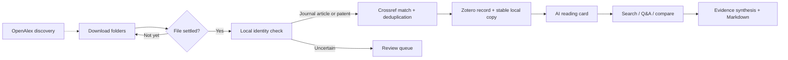

<div align="center">
  

  <h3>自动收文 · AI 速读 · 语义匹配</h3>

  <p>
    <strong>Turn a chaotic download folder into a private research desk.</strong><br>
    Automatic Zotero intake, evidence-grounded paper Q&amp;A, and sourced mini-reviews.
  </p>

  <p>
    <a href="https://github.com/segayi1/scholarloom/actions/workflows/ci.yml"></a>
    
    
    <a href="LICENSE"></a>
  </p>

  <p><strong>English</strong> · <a href="README.zh-CN.md">简体中文</a></p>
</div>

ScholarLoom watches the places where papers actually arrive, verifies each file before import, and keeps Zotero as the source of truth. Its reading desk then connects summaries, full-text questions, comparisons, and new-paper discovery without sending your library to a hosted ScholarLoom account.

> **From download to understanding in one continuous path.** Files are checked locally, metadata is resolved through Crossref, verified papers and patents enter Zotero, and every AI answer can point back to a paper or PDF page.

## Three moves. One research loop.

| Capture | Understand | Connect |
| :--- | :--- | :--- |
| Watch folders, verify identity, remove duplicates, and place clean records in Zotero. | Generate reading cards, ask the paper a question, and keep a personal reading state. | Search bilingually with explanations, compare evidence, build a mini-review, or discover related work. |

## What ScholarLoom does

### Intake that handles the messy part

- **Watch without babysitting.** Add one or more download folders. ScholarLoom waits for PDF and EPUB files to settle, then moves each one through a visible queue.
- **Verify before trusting a filename.** It reads the opening pages locally, extracts DOI or patent-number signals, queries Crossref, and requires the local title and publisher metadata to agree.
- **Keep the library clean.** Content hashes, DOI values, and patent numbers stop the same work from entering twice. Accepted full texts are copied to a stable local library while the originals in Downloads stay untouched.
- **Leave uncertainty visible.** Verified journal articles and patents enter Zotero with topic collections, source tags, and linked full texts. Ambiguous or mismatched files stay in a review queue.
- **Work without a model.** Automatic import and Zotero organization can run without an AI endpoint. Pending reading cards can be generated later.

### A reading desk built around the paper

- **Turn abstracts into a map.** A structured reading card captures the central claim, research question, model, methods, findings, use case, limitations, and the evidence behind the summary.
- **Ask the paper, then jump to the source.** Query up to 60 extracted PDF pages. Answers cite `[Page N]`, and each citation opens the matching Zotero attachment at that page.
- **Synthesize instead of stacking summaries.** Compare 2–4 papers side by side or select 5–12 for a focused mini-review. Larger selections use a numbered evidence ledger, an optional focus question, and a cautious 250–500-word synthesis.
- **Keep the trail.** Paper claims use stable `[P1]`–`[P12]` identifiers, records without a reading card stay marked as metadata only, and the finished review can be copied or downloaded as Markdown.
- **Keep a reading workflow.** Mark papers unread, reading, or read; save a private note; filter by status; and open the latest seven days from the home view.

### Search and discovery with evidence in view

- **Match ideas across languages.** Local synonym groups connect concepts such as `single B-cell`, `单B细胞`, and `单细胞抗体`, then rank matches across titles, authors, identifiers, questions, methods, findings, and use cases.
- **See why a result appeared.** Every result highlights the direct query terms and names the fields that matched. There is no opaque vector service in the local search path.
- **Explore beyond the shelf.** Switch to `Discover online` for a free OpenAlex topic search, or request related papers from an individual reading card.
- **Bring useful open-access papers back.** Results show citation counts and OA status. A validated public HTTPS PDF can enter the same inbox, deduplication, Zotero, and reading-card workflow with one click.

### Control where control matters

- **Local by default.** The server binds to `127.0.0.1`, write requests require a per-process CSRF token, private text fields stay out of public browser responses, and secrets are kept outside Git.
- **Bring your own model.** Use any OpenAI-compatible Chat Completions endpoint. ScholarLoom works with the endpoint you configure and does not bundle a literature corpus or hosted account.
- **Choose languages independently.** Switch the interface between English and Simplified Chinese; separately choose `Follow interface`, `简体中文`, or `English` for AI output.
- **Edit the research prompts.** Six bilingual presets cover methods and evidence, negative results, mechanistic contribution, translational assessment, cross-paper arbitration, and reading-card extraction. Every preset can be restored to its shipped text.

## From file to finding



Every step leaves a visible status. If the network, Zotero, or the model is unavailable, the item returns to a recoverable queue instead of disappearing.

## Quick start

### Requirements

- Python 3.12+
- Zotero Desktop with its local API enabled
- PyMuPDF (`pip install -r requirements.txt`)
- Node.js 20+ only for the optional JavaScript checks
- An OpenAI-compatible Chat Completions endpoint, model name, and API key for AI reading, Q&amp;A, and synthesis
- Internet access to `api.openalex.org` for optional external discovery

### Run it

```sh
git clone https://github.com/segayi1/scholarloom.git
cd scholarloom
python -m pip install -r requirements.txt
python server.py
```

Open `http://127.0.0.1:8766`.

Windows users can double-click `launch.vbs`. PowerShell and POSIX users can run `./start.ps1` or `./start.sh`.

### Connect the pieces

1. In Zotero, open `Settings -> Advanced` and enable **Allow other applications on this computer to communicate with Zotero**.
2. In ScholarLoom's `Settings` tab, click **Connect Zotero**. Choose **Always Allow** in Zotero if you want future background imports.
3. Enter an OpenAI-compatible HTTPS API base URL, model name, and API key. Local loopback endpoints may use HTTP.
4. Choose the AI output language, save the settings, and run **Test research model**.
5. Add a folder to watch. Existing files in a newly added folder are baselined; use **Add existing downloads** when you want them processed.

## Privacy and data

No literature records, PDFs, database contents, API keys, or Zotero snapshots are included in this repository. A fresh clone starts with an empty library.

| Local path | Purpose | Tracked |
| :--- | :--- | :---: |
| `data/workbench.sqlite` | Documents, jobs, settings, hashes | No |
| `data/secrets.bin` | Encrypted API key and Zotero authorization | No |
| `data/Library/` | Stable copies of imported full texts | No |
| `data/seed.json` | Optional local starting records | No |
| `data/guides.json` | Optional topic guides and reading routes | No |
| `web/` | Browser interface | Yes |

On Windows, secrets and Zotero authorization are encrypted with the current user's DPAPI credentials. On other systems, `data/secrets.bin` is stored locally without DPAPI protection; keep it private.

Model requests go only to the endpoint configured in Settings and may incur provider charges. OpenAlex queries contain the search topic or DOI and require no account. ScholarLoom does not bypass publisher paywalls or Zotero permission prompts.

## Quality checks

```sh
python -m unittest -v test_pipeline.py test_server.py
node test_web.js
node --check web/app.js
```

GitHub Actions runs the Python suite and JavaScript syntax check on pushes and pull requests.

## Documentation

| Start here | Go deeper |
| :--- | :--- |
| [Usage guide](docs/USAGE.md) | Imports, reading workflow, Q&amp;A, synthesis, and discovery |
| [Data format](docs/DATA_FORMAT.md) | Settings, storage shape, seed files, and private fields |
| [Contributing](CONTRIBUTING.md) | Development setup and contribution flow |
| [Security policy](SECURITY.md) | Vulnerability reporting and trust boundaries |
| [Changelog](CHANGELOG.md) | Features and fixes by release |

## Contributors

**Primary contributor and maintainer:** [segayi1](https://github.com/segayi1)

## License

MIT. See [LICENSE](LICENSE).
