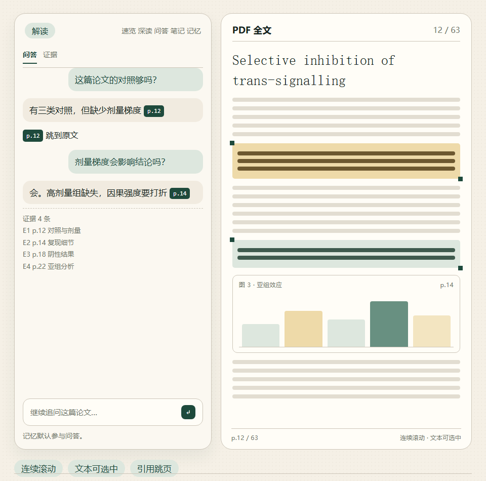

<div align="center">
  

  <h3>Automatic intake · Evidence-grounded reading · Project memory</h3>

  <p>
    <strong>Turn a crowded download folder into a research desk that remembers.</strong><br>
    ScholarLoom watches incoming papers, verifies each record, and connects parallel reading, page-level evidence, project notes, and cross-paper synthesis in one local workspace.
  </p>

  <p>
    <a href="https://github.com/segayi1/scholarloom/actions/workflows/ci.yml"></a>
    <a href="https://github.com/segayi1/scholarloom/releases/latest"></a>
    
    
    
    
    <a href="LICENSE"></a>
  </p>

  <p>
    <a href="https://github.com/segayi1/scholarloom/releases/latest"><strong>Download latest</strong></a>
    ·
    <a href="#quick-start">Quick start</a>
    ·
    <a href="#two-entry-points-one-library">DSH plugin</a>
    ·
    <a href="#documentation">Documentation</a>
  </p>

  <p>
    <strong>New · DeepSeek Harness plugin:</strong> one more entry point to the same library.
    <a href="#two-entry-points-one-library">See the panel →</a>
  </p>

  <p><strong>English</strong> · <a href="README.zh-CN.md">简体中文</a></p>
</div>

> **From incoming file to traceable synthesis.** ScholarLoom verifies papers before import, keeps every useful answer close to the page that supports it, and turns reading notes into reusable research state.

## One workspace for the whole reading loop

| Capture | Read | Connect |
| :--- | :--- | :--- |
| Watch the folders where papers actually arrive, verify each record, remove duplicates, and build a clean local library. | Open papers in parallel tabs, ask questions with page citations, study figures beside the source, and save excerpts and project notes. | Search across your library, compare 2–12 papers, generate a focused mini-review, and discover related open-access work. |

<div align="center">
  
</div>

## The 60-second tour

<table>
  <tr>
    <td width="25%"><strong>1 · Drop papers</strong><br>ScholarLoom waits for downloads to settle, checks the record, and keeps uncertain files in review.</td>
    <td width="25%"><strong>2 · Read with anchors</strong><br>Ask about a paper, inspect figures, and jump from an answer back to the supporting page.</td>
    <td width="25%"><strong>3 · Build context</strong><br>Save excerpts, project memory, reading sessions, and searchable full-text passages.</td>
    <td width="25%"><strong>4 · Connect evidence</strong><br>Compare papers in an editable matrix or turn bounded passages into a focused draft.</td>
  </tr>
</table>

<p align="center"><strong>Start with one paper. Keep the evidence. Let the project grow.</strong></p>

## Two entry points, one library

The same local library opens in the browser or inside DeepSeek Harness. Neither is a copy: both read the same `data/`, and the DSH plugin is only an entry point—no second database, no separate model settings, no new remote service.

<table>
  <tr>
    <td width="50%"><strong>Browser workbench</strong><br><code>server.py</code> + <code>web/</code> at <code>127.0.0.1:8766</code>. Full intake, settings, Zotero, synthesis, and administration.</td>
    <td width="50%"><strong>DeepSeek Harness panel</strong><br>The optional <a href="dsh-plugin/"><code>dsh-plugin/</code></a> adds library search, reading cards, continuous PDF, page-grounded Q&amp;A, notes, memory, and four agent tools to the DSH sidebar.</td>
  </tr>
</table>

<p align="center">
  
</p>

```powershell
powershell -ExecutionPolicy Bypass -File .\dsh-plugin\install.ps1 -Profile desktop
```

Both can run at once. Configuration is separate: the local app owns the port, model/Zotero settings, and `data/`; the plugin has `baseUrl`, `projectDir`, `pythonPath`, `autoStart`, and `requestTimeoutMs`. See [configuration](docs/CONFIGURATION.md).

Agent tools: `scholarloom_search`, `scholarloom_paper`, `scholarloom_ask`, `scholarloom_status`.

[Plugin README](dsh-plugin/README.md) · [Install, configuration, and security boundary](docs/DSH_PLUGIN.md)

## Pick your starting point

| You want to… | Start here |
| :--- | :--- |
| Use it inside DeepSeek Harness | [DSH plugin](#two-entry-points-one-library) · [Setup](docs/DSH_PLUGIN.md) |
| Clean up a busy download folder | [Quick start](#quick-start) · [Usage guide](docs/USAGE.md) |
| Ask questions that return to the PDF | [Evidence and Q&A](docs/USAGE.md#evidence-grounded-reading) |
| Compare several papers | [Project retrieval and synthesis](docs/USAGE.md#comparison-synthesis) |
| Connect your existing library | [Optional Zotero authorization](#authorizations-and-optional-services) |
| Understand the trust boundary | [Security policy](SECURITY.md) · [Data format](docs/DATA_FORMAT.md) |

## Why ScholarLoom

### Intake that removes clutter

ScholarLoom waits for downloads to settle, reads the opening pages, checks DOI or patent signals against public metadata, and keeps ambiguous files in a review queue. Accepted papers move into a stable local library while the originals stay where they are.

### Answers you can inspect

Reading cards summarize the paper. Dossiers go further with an outline, argument chain, methods audit, author-stated claims, and reusable notes. Answers cite pages where evidence can be located, and every located citation jumps back into the PDF. Citation coverage is shown separately, so the evidence boundary of each answer stays visible.

### A memory you can edit

Save excerpts, project context, preferences, and completed Q&A. Project and paper scopes keep recall relevant; memory can be reviewed, revised, or deleted. Export a project as Markdown or the full reading history as JSON.

### A workspace that stays yours

Run the workbench on `127.0.0.1`, keep the library in SQLite and local files, and connect Zotero only when you want bibliographic organization. Use any OpenAI-compatible Chat Completions endpoint for AI features, or keep the intake and reading workspace running without one.

### What stays local

| On your machine by default | Sent only when the feature needs it |
| :--- | :--- |
| PDFs, SQLite library, reading memory, project drafts, and session history | Selected passages sent to the configured AI endpoint |
| Model credentials protected by the local settings store | Metadata lookups through Crossref, arXiv, or OpenAlex |
| Browser UI and PDF.js reader | Selected text sent to the online translation fallback |

The core reader and local search do not require an account. You choose whether to configure an AI endpoint, connect Zotero, or use online translation.

## New in 2.1

- **Whole-paper deep reading.** Analyze every page, group experiments into units, generate a cross-page overview, follow source anchors, resume interrupted runs, and stop a running job.
- **Project retrieval and evidence matrices.** Search all project PDFs, compare 2–12 papers in an editable matrix, save human revisions separately from generated values, and inspect source-version conflicts.
- **Project research drafts.** Build a focused synthesis from bounded full-text passages, save revisions, and keep source IDs and locatable excerpts.
- **Named reading sessions.** Keep separate lines of inquiry inside one paper, restore drafts and selections, export a session, and avoid duplicate replies after retries.
- **Reader and desktop workflow.** Work with parallel tabs, fixed navigation and scrolling, adjustable reader columns, paragraph interpretation, manual figure links, and a Windows launcher with in-progress work protection.
- **Stronger evidence boundaries.** Validate overviews, surface formulation conflicts, reject stale evidence positions, and label model interpretations separately from paper evidence.

## Download and automatic setup

Every release contains the same source tree: no build step, package manager, or cloud account is required for local intake and reading.

### Windows PowerShell

```powershell
$zip = "$env:TEMP\ScholarLoom-2.1.2.zip"
$dst = Join-Path $env:LOCALAPPDATA "ScholarLoom"
Invoke-WebRequest "https://github.com/segayi1/scholarloom/releases/latest/download/ScholarLoom-2.1.2.zip" -OutFile $zip
Expand-Archive $zip $dst -Force
Set-Location (Join-Path $dst "ScholarLoom-2.1.2")
.\setup.ps1
```

Then double-click `launch.vbs`.

### macOS and Linux

```sh
curl -fL https://github.com/segayi1/scholarloom/releases/latest/download/ScholarLoom-2.1.2.tar.gz -o /tmp/ScholarLoom-2.1.2.tar.gz
tar -xzf /tmp/ScholarLoom-2.1.2.tar.gz
cd ScholarLoom-2.1.2
./setup.sh
./start.sh
```

`setup.cmd`, `setup.ps1`, and `setup.sh` create `.venv`, install the pinned dependencies, and verify the runtime imports. The optional offline translation model can be downloaded separately:

Windows PowerShell:

```powershell
.\.venv\Scripts\python.exe install-translation-model.py
```

macOS/Linux:

```sh
.venv/bin/python install-translation-model.py
```

## Quick start

### Windows

1. [Download the latest release](https://github.com/segayi1/scholarloom/releases/latest) and extract it outside a protected system folder.
2. Double-click `setup.cmd` once to create `.venv` and install dependencies.
3. Double-click `launch.vbs` and open `http://127.0.0.1:8766`, or use `launch-desktop.ps1` for `http://127.0.0.1:8767`.

### macOS and Linux

```sh
tar -xzf ScholarLoom-2.1.2.tar.gz
cd ScholarLoom-2.1.2
chmod +x setup.sh start.sh
./setup.sh
./start.sh
```

Open `http://127.0.0.1:8766`.

### Authorizations and optional services

- **Local workspace:** no account or API key is required for intake, the PDF reader, project organization, or local search.
- **AI model:** open Settings, enter an OpenAI-compatible endpoint, model name, and API key, then use **Test model**. On Windows the key is encrypted with the current user's DPAPI context; it is never sent to the browser or written into reading records. A loopback endpoint can omit the key.
- **Zotero:** click the Zotero connection button and choose **Always Allow** once. This is the interface for optional collection, tag, and linked-attachment writes; the grant can be revoked in Zotero.
- **Translation:** browser-local translation needs a browser language-pack permission on first use. The online fallback sends only the selected passage to `translate.googleapis.com`. The optional offline model is installed by the command above or by the button in Settings.
- **Downloads:** the core setup scripts require network access only while installing Python packages. The offline translation model is a separate download and is not included in the release archive.

Generated summaries and syntheses remain model interpretations: a locatable citation confirms the source page, while claim-level scientific review remains required.

## Built with

Python 3.12 · SQLite · PDF.js · Crossref · arXiv · OpenAlex · optional Zotero · any OpenAI-compatible Chat Completions endpoint

The server binds to localhost, and the browser UI ships with the project. Development checks are documented in [CONTRIBUTING.md](CONTRIBUTING.md), and GitHub Actions runs the full Python and JavaScript suites on pushes and pull requests.

## Documentation

| Start here | Go deeper |
| :--- | :--- |
| [DSH plugin](dsh-plugin/README.md) | Native DeepSeek Harness panel, agent tools, installation, and configuration |
| [Usage guide](docs/USAGE.md) | Intake, reading, Q&A, memory, figures, synthesis, and discovery |
| [Project memory](docs/PROJECT_MEMORY.md) | Product direction, architecture, and known gaps |
| [Data format](docs/DATA_FORMAT.md) | Storage shape, settings, and private fields |
| [Contributing](CONTRIBUTING.md) | Development setup and contribution flow |
| [Security policy](SECURITY.md) | Vulnerability reporting and trust boundaries |
| [Changelog](CHANGELOG.md) | Features and fixes by release |
| [Launch copy](docs/promotion/dsh-workbench/copy.md) | 7-slide Xiaohongshu carousel and post copy |

## Contributors

**Primary contributor and maintainer:** [segayi1](https://github.com/segayi1)

## License

ScholarLoom's original source code is available under the [MIT License](LICENSE).
Third-party components keep their own licenses; in particular, PyMuPDF is
AGPL-3.0 or commercially licensed. See
[Third-Party Notices](THIRD_PARTY_NOTICES.md) before redistribution.
