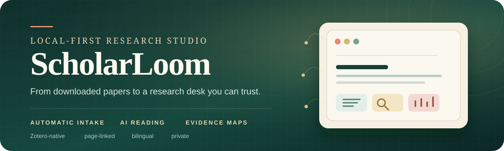
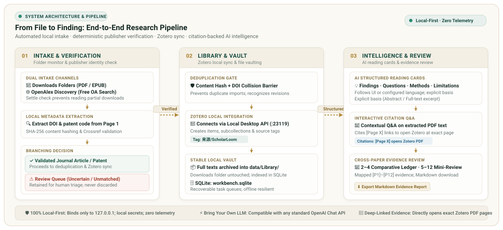

<div align="center">
  

  <h3>自动收文 · 证据研读 · 阅读记忆</h3>

  <p>
    <strong>Turn a chaotic download folder into a private research desk.</strong><br>
Local-first intake, a multi-paper evidence reader, page-grounded AI dossiers, and personal reading memory.
  </p>

  <p>
    <a href="https://github.com/segayi1/scholarloom/actions/workflows/ci.yml"></a>
    <a href="https://github.com/segayi1/scholarloom/releases/latest"></a>
    
    
    <a href="LICENSE"></a>
  </p>

  <p><strong>English</strong> · <a href="README.zh-CN.md">简体中文</a></p>
</div>

ScholarLoom watches the places where papers actually arrive and verifies each file before import. Verified papers are always kept in a stable local library; connecting Zotero additionally writes the parent record, collection, tags, and linked attachment there. Its reading desk then connects summaries, full-text questions, comparisons, and new-paper discovery without sending your library to a hosted ScholarLoom account.

> **From download to understanding in one continuous path.** Files are checked locally, metadata is resolved through Crossref, verified papers and patents enter the local library, and every AI answer can point back to a paper or PDF page.

## New in 2.0

- **A real reading workspace.** Open several papers in separate tabs, keep their pages and zoom levels, and resume the last session after a reload.
- **Evidence below every answer.** Workbench 2.0 validates page citations, lets every cited passage jump back into the PDF, and exports selected excerpts with page and source state.
- **Memory with boundaries.** Completed Q&amp;A, explicit project memories, and saved excerpts persist locally with project isolation, edit/delete controls, bounded context, and JSON or Markdown export.
- **Go beyond the summary.** Generate an on-demand dossier with reading decision, paper outline, argument chain, methods audit, reusable notes, and page-locatable evidence.
- **Read figures and language in context.** Select a figure for a high-resolution crop and project note; translate selected PDF text with browser-local, online, or optional offline models.
- **Recover instead of restart.** Failed reading-card batches remain inspectable and retryable, while database and library health checks support an online backup.

## Three moves. One research loop.

| Capture | Understand | Connect |
| :--- | :--- | :--- |
| Watch folders, verify identity, remove duplicates, and save clean local records. | Generate reading cards, ask the paper a question, and keep a personal reading state. | Search bilingually with explanations, compare evidence, build a mini-review, or discover related work. |

## What ScholarLoom does

### Intake that handles the messy part

- **Watch without babysitting.** Add one or more download folders and use the header switch to pause or resume monitoring independently of Zotero. ScholarLoom waits for PDF and EPUB files to settle, then moves each one through a visible queue.
- **Verify before trusting a filename.** It reads the opening pages locally, extracts DOI or patent-number signals, queries Crossref, and requires the local title and publisher metadata to agree.
- **Keep the library clean.** Content hashes, DOI values, and patent numbers stop the same work from entering twice. Accepted full texts are copied to a stable local library while the originals in Downloads stay untouched.
- **Leave uncertainty visible.** DOI-backed journal articles, structurally verified patents, and title-matched arXiv or Crossref preprints enter the local library automatically and are written to Zotero when connected. Title-only journal matches, mismatched files, unverified preprints, and other ambiguous PDFs stay in a review queue with an explicit manual-import action. Defense presentations, course lesson plans, lecture courseware, and other obvious non-literature are excluded from the default inbox while remaining available in the audit filter.
- **Work without a model or Zotero.** Automatic local intake, the reading desk, and optional Zotero organization can run without an AI endpoint. Pending reading cards can be generated later.

### A reading desk built around the paper

- **Turn abstracts into a decision.** A structured reading card captures the central claim, research question, model, methods, findings, use case, limitations, and a reading decision with fit, focus, concerns, and next action.
- **Keep several papers open.** The embedded PDF.js reader uses browser-like tabs with independent page and zoom state. Reloading restores the open papers without replacing the active reading position.
- **Ask the paper, then jump to the source.** Query up to 60 extracted PDF pages. Answers cite `[Page N]`; every located citation opens the matching page and highlights the passage. Coverage is shown separately from the answer.
- **Build a deeper reading path on demand.** Generate a dossier containing a page-grounded outline, argument roles, author-stated claims, methods audit, reusable notes, and explicit inferred or unsupported items.
- **Keep the evidence trail.** Select text in the PDF to ask a question, save an excerpt, or translate it. Excerpts retain paper, page, project, and source state; project exports produce Markdown and the complete reading history can be exported as JSON.
- **Keep a personal research memory.** Completed Q&amp;A, confirmed preferences, project context, and hypotheses persist locally. Project and paper scope bound recall, revisions retire old memories, and disabled recall leaves the current exchange unpersonalized.
- **Study figures with the surrounding text.** Drag over a figure or panel for a high-resolution local crop, search caption and in-text reference candidates, save a project note, and return to the source page. A changed PDF marks the selection stale.
- **Synthesize instead of stacking summaries.** Compare 2–4 papers side by side or select 5–12 for a focused mini-review. Larger selections use a numbered evidence ledger, an optional focus question, and a cautious 250–500-word synthesis.
- **Keep the comparison traceable.** Paper claims use stable `[P1]`–`[P12]` identifiers, records without a reading card stay marked as metadata only, and current dossiers enrich comparison while the finished review can be copied or downloaded as Markdown.
- **Keep a reading workflow.** Mark papers unread, reading, or read; save a private note; filter by status; and open the latest seven days from the home view.

### Search and discovery with evidence in view

- **Match ideas across languages.** Local synonym groups connect concepts such as `single B-cell`, `单B细胞`, and `单细胞抗体`, then rank matches across titles, authors, identifiers, questions, methods, findings, and use cases.
- **See why a result appeared.** Every result highlights the direct query terms and names the fields that matched. There is no opaque vector service in the local search path.
- **Explore beyond the shelf.** Switch to `Discover online` for a free OpenAlex topic search, or request related papers from an individual reading card.
- **Bring useful open-access papers back.** Results show citation counts and OA status. A validated public HTTPS PDF can enter the same inbox, deduplication, local save, optional Zotero, and reading-card workflow with one click.

### Control where control matters

- **Local by default.** The server binds to `127.0.0.1`, write requests require a per-process CSRF token, private text fields stay out of public browser responses, and secrets are kept outside Git.
- **Bring your own model.** Use any OpenAI-compatible Chat Completions endpoint. ScholarLoom works with the endpoint you configure and does not bundle a literature corpus or hosted account.
- **Choose languages independently.** Switch the interface between English and Simplified Chinese; separately choose `Follow interface`, `简体中文`, or `English` for AI output.
- **Translate without spending research-model tokens.** Selected text can use the browser Translator API, a free online fallback, or an optional offline model. Settings show download size, disk use, privacy boundary, and quality warnings before installation.
- **Edit the research prompts.** Six bilingual presets cover methods and evidence, negative results, mechanistic contribution, translational assessment, cross-paper arbitration, and reading-card extraction. Every preset can be restored to its shipped text.
- **Recover and inspect.** Failed reading-card batches can be expanded and retried individually. Backup and health controls verify SQLite and the local attachment library before copying an online-consistent snapshot.

## From file to finding

<div align="center">
  
</div>

Every step leaves a visible status. If the network, Zotero, or the model is unavailable, the item remains recoverable; local saving does not depend on Zotero.

## Quick start

### Requirements

- Python 3.12+
- Zotero Desktop with its local API enabled only when you want Zotero organization
- Node.js 20+ only for the optional JavaScript checks
- An OpenAI-compatible Chat Completions endpoint, model name, and API key for AI reading, Q&amp;A, and synthesis
- Internet access to `api.openalex.org` for optional external discovery

### Windows: download and run

1. Open [Releases](https://github.com/segayi1/scholarloom/releases/latest) and download `scholarloom-v2.0.0.zip`.
2. Extract the archive anywhere outside a protected system folder.
3. Double-click `setup.cmd` once. It creates `.venv` and installs the Python dependencies.
4. Double-click `launch.vbs`. ScholarLoom starts locally and opens `http://127.0.0.1:8766`.

### Run from source

```sh
git clone https://github.com/segayi1/scholarloom.git
cd scholarloom
./setup.sh
./start.sh
```

Open `http://127.0.0.1:8766`.

Windows source checkouts can run `setup.cmd`, `start.ps1`, or `launch.vbs`.

### Connect the pieces

1. Add a folder to watch and use the header monitoring switch to pause or resume scanning.
2. Optionally, open Zotero `Settings -> Advanced` and enable **Allow other applications on this computer to communicate with Zotero**.
3. Optionally, in ScholarLoom's `Settings` tab, click **Connect Zotero**. Choose **Always Allow** in Zotero if you want future background Zotero writes.
4. Enter an OpenAI-compatible HTTPS API base URL, model name, and API key. Local loopback endpoints may use HTTP.
5. Choose the AI output language, save the settings, and run **Test research model**.
6. Existing files in a newly added folder are baselined; use **Add existing downloads** when you want them processed.

## Privacy and data

No literature records, PDFs, database contents, API keys, or Zotero snapshots are included in this repository. A fresh clone starts with an empty library.

| Local path | Purpose | Tracked |
| :--- | :--- | :---: |
| `data/workbench.sqlite` | Documents, jobs, settings, reading memory, dossiers, excerpts, and figure notes | No |
| `data/secrets.bin` | Encrypted API key and Zotero authorization | No |
| `data/Library/` | Stable copies of imported full texts | No |
| `data/translator/` | Optional downloaded offline translation model | No |
| `data/seed.json` | Optional local starting records | No |
| `data/guides.json` | Optional topic guides and reading routes | No |
| `web/` | Browser interface | Yes |

On Windows, secrets and Zotero authorization are encrypted with the current user's DPAPI credentials. On other systems, `data/secrets.bin` is stored locally without DPAPI protection; keep it private.

Model requests go only to the endpoint configured in Settings and may incur provider charges. They contain bounded paper text and the reading context needed for the requested action; PDF files and figure images are not uploaded. OpenAlex queries contain the search topic or DOI and require no account. The optional online translation fallback sends only selected text to `translate.googleapis.com`. ScholarLoom does not bypass publisher paywalls or Zotero permission prompts.

## Quality checks

```sh
python -m unittest -v test_evidence.py test_pipeline.py test_server.py test_memory.py test_figure.py test_dossier.py test_local_translation.py
node test_web.js
node test_translation.js
node --check web/app.js
node --check web/translation.js
```

GitHub Actions runs the complete Python and JavaScript suites on pushes and pull requests.

## Documentation

| Start here | Go deeper |
| :--- | :--- |
| [Project memory](docs/PROJECT_MEMORY.md) | Product history, architecture, data boundaries, and known gaps |
| [Usage guide](docs/USAGE.md) | Imports, reading workflow, Q&amp;A, synthesis, and discovery |
| [Data format](docs/DATA_FORMAT.md) | Settings, storage shape, seed files, and private fields |
| [Contributing](CONTRIBUTING.md) | Development setup and contribution flow |
| [Security policy](SECURITY.md) | Vulnerability reporting and trust boundaries |
| [Changelog](CHANGELOG.md) | Features and fixes by release |

## Contributors

**Primary contributor and maintainer:** [segayi1](https://github.com/segayi1)

## License

MIT. See [LICENSE](LICENSE).
