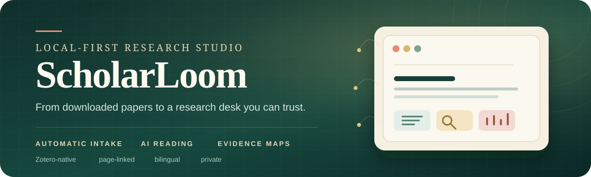
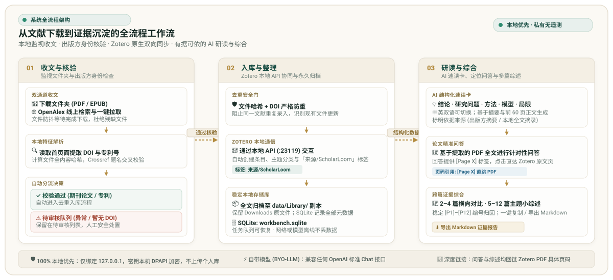

<div align="center">
  

  <h3>自动收文 · AI 速读 · 语义匹配</h3>

  <p>
    <strong>把杂乱的下载文件夹变成私人科研工作台。</strong><br>
    自动导入 Zotero、有证据依据的论文问答，以及带来源的小综述。
  </p>

  <p>
    <a href="https://github.com/segayi1/scholarloom/actions/workflows/ci.yml"></a>
    
    
    <a href="LICENSE"></a>
  </p>

  <p><a href="README.md">English</a> · <strong>简体中文</strong></p>
</div>

ScholarLoom 会监视文献真正进入电脑的位置，在导入前核验文件，并让 Zotero 继续作为资料来源。研读区再把速读、全文问答、文献比较和新文献发现连到一起，同时不把你的文献库发送到 ScholarLoom 的托管账号。

> **从下载到理解，一条连续路径。** 文件在本地完成检查，元数据通过 Crossref 解析，核验后的期刊论文和专利进入 Zotero，AI 给出的每个回答都能回到论文或具体 PDF 页面。

## 三条主线，一个完整研究闭环

| 收文 | 研读 | 连接 |
| :--- | :--- | :--- |
| 监视文件夹、核验身份、去除重复文件，并把干净的记录放入 Zotero。 | 生成结构化速读、向论文提问，并维护自己的阅读状态。 | 使用可解释的双语检索，比较文献证据，生成小综述，或发现相关研究。 |

## ScholarLoom 能做什么

### 把最杂乱的环节自动化

- **自动监视，无需反复守候。** 添加一个或多个下载文件夹。ScholarLoom 会等待 PDF 和 EPUB 下载完成，再让每个文件通过可见的队列。
- **先核验，再相信文件名。** 它在本地读取文件首页，提取 DOI 或专利号信号，查询 Crossref，并要求本地题名与出版方元数据相互吻合。
- **保持资料库干净。** 内容哈希、DOI 和专利号会阻止同一篇文献重复进入。核验通过的全文会复制到稳定的本地资料库，Downloads 中的原文件保持不变。
- **把不确定性明确留下。** 核验后的期刊论文和专利会进入 Zotero，并带有主题分类、来源标签和全文链接。模糊或不匹配的文件则留在待审核队列。
- **没有模型也能工作。** 自动导入和 Zotero 整理不依赖 AI 服务。待生成的速读可以稍后再处理。

### 围绕论文建立的研读工作台

- **把摘要变成研究地图。** 结构化速读覆盖核心结论、研究问题、模型、方法、发现、应用场景、局限，以及摘要所依据的证据来源。
- **先问论文，再跳到原文。** 可对最多 60 页已提取的 PDF 文本提问。回答使用 `[Page N]` 引用页码，点击引用可打开 Zotero 中对应的 PDF 页面。
- **跨篇综合，而不是堆叠摘要。** 2–4 篇文献并排比较；选择 5–12 篇时生成聚焦小综述。较大的集合会使用带编号的证据台账、可选的聚焦问题，以及一段谨慎的 250–500 字综合结论。
- **保留每条证据线索。** 论文观点使用固定的 `[P1]`–`[P12]` 编号；没有速读记录的文献会明确标为仅元数据；完成的综述可复制或下载为 Markdown。
- **维护阅读流程。** 将论文标记为未读、在读或已读，保存私人笔记，按状态筛选，并在首页查看最近 7 天新增的文献。

### 让检索依据始终可见

- **跨语言匹配相近概念。** 本地同义词组可以连接 `single B-cell`、`单B细胞` 和 `单细胞抗体` 等表达，再在题名、作者、标识符、研究问题、方法、发现和应用场景之间排序。
- **看见结果为什么出现。** 每条结果都会高亮直接命中的查询词，并说明命中了哪些字段。本地检索不依赖封闭的向量服务。
- **走出已有书架。** 切换到 `Discover online` 可免费检索 OpenAlex，也可以从某一篇论文的速读卡查找相关研究。
- **把有价值的开放论文带回来。** 结果显示引用次数和开放获取状态。经过验证的公开 HTTPS PDF 可以一键进入同一个收件箱，继续去重、Zotero 导入和速读流程。

### 把关键控制权留在本地

- **默认本地运行。** 服务只绑定 `127.0.0.1`，写请求需要进程级 CSRF 令牌，私有正文字段不会出现在公开浏览器响应中，密钥也不会进入 Git。
- **使用你自己的模型。** 支持任意 OpenAI Chat Completions 兼容接口。ScholarLoom 使用你配置的端点，不附带文献语料库，也不要求托管账号。
- **分别选择界面和 AI 语言。** 界面可切换英文或简体中文；AI 输出可单独选择 `跟随界面`、`简体中文` 或 `English`。
- **可编辑研究提示词。** 六套中英双语提示词覆盖方法与证据、阴性结果、机制贡献、转化评估、跨篇仲裁和结构化速读。所有提示词都可以恢复为内置版本。

## 从文件到发现

<div align="center">
  
</div>

每一步都有可见状态。网络、Zotero 或模型暂时不可用时，条目会回到可恢复的队列，不会消失。

## 快速开始

### 环境要求

- Python 3.12+
- 已启用本地 API 的 Zotero Desktop
- PyMuPDF（`pip install -r requirements.txt`）
- Node.js 20+，仅用于可选的 JavaScript 检查
- 用于 AI 研读、问答和综述的 OpenAI Chat Completions 兼容接口、模型名和 API Key
- 用于可选外部发现的 `api.openalex.org` 访问权限

### 运行

```sh
git clone https://github.com/segayi1/scholarloom.git
cd scholarloom
python -m pip install -r requirements.txt
python server.py
```

打开 `http://127.0.0.1:8766`。

Windows 用户可双击 `launch.vbs`。PowerShell 和 POSIX 用户可运行 `./start.ps1` 或 `./start.sh`。

### 连接各项服务

1. 在 Zotero 中打开 `Settings -> Advanced`，启用 **Allow other applications on this computer to communicate with Zotero**。
2. 在 ScholarLoom 的 `Settings` 标签中点击 **Connect Zotero**。如需后台持续导入，请在 Zotero 中选择 **Always Allow**。
3. 输入 OpenAI 兼容的 HTTPS API 基础地址、模型名和 API Key。本机回环地址可以使用 HTTP。
4. 选择 AI 输出语言，保存设置，并运行 **Test research model**。
5. 添加需要监视的文件夹。新加入文件夹中的已有文件会先建立基线；需要处理时，使用 **Add existing downloads**。

## 隐私与数据

本仓库不包含任何文献记录、PDF、数据库内容、API Key 或 Zotero 快照。新克隆的项目会从空资料库开始。

| 本地路径 | 用途 | 是否进入 Git |
| :--- | :--- | :---: |
| `data/workbench.sqlite` | 文献、任务、设置和哈希 | 否 |
| `data/secrets.bin` | 加密后的 API Key 与 Zotero 授权 | 否 |
| `data/Library/` | 已导入全文的稳定本地副本 | 否 |
| `data/seed.json` | 可选的本地初始记录 | 否 |
| `data/guides.json` | 可选的主题指南与阅读路线 | 否 |
| `web/` | 浏览器界面 | 是 |

Windows 上，密钥和 Zotero 授权使用当前用户的 DPAPI 凭据加密。其他系统中，`data/secrets.bin` 仅保存在本机但不使用 DPAPI；请妥善保护。

模型请求只会发往设置中配置的接口，并可能产生服务商费用。OpenAlex 查询只包含检索主题或 DOI，无需账号。ScholarLoom 不会绕过出版方付费墙或 Zotero 权限确认。

## 质量检查

```sh
python -m unittest -v test_pipeline.py test_server.py
node test_web.js
node --check web/app.js
```

GitHub Actions 会在推送和 Pull Request 时运行 Python 测试和 JavaScript 语法检查。

## 文档

| 从这里开始 | 深入了解 |
| :--- | :--- |
| [使用指南](docs/USAGE.md) | 导入、阅读流程、问答、综述与外部发现 |
| [数据格式](docs/DATA_FORMAT.md) | 设置、存储结构、种子文件和私有字段 |
| [参与贡献](CONTRIBUTING.md) | 开发环境与贡献流程 |
| [安全策略](SECURITY.md) | 漏洞报告与信任边界 |
| [更新日志](CHANGELOG.md) | 各版本的功能与修复 |

## 贡献者

**主要贡献人与维护者：** [segayi1](https://github.com/segayi1)

## 许可证

MIT，详见 [LICENSE](LICENSE)。
